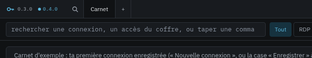
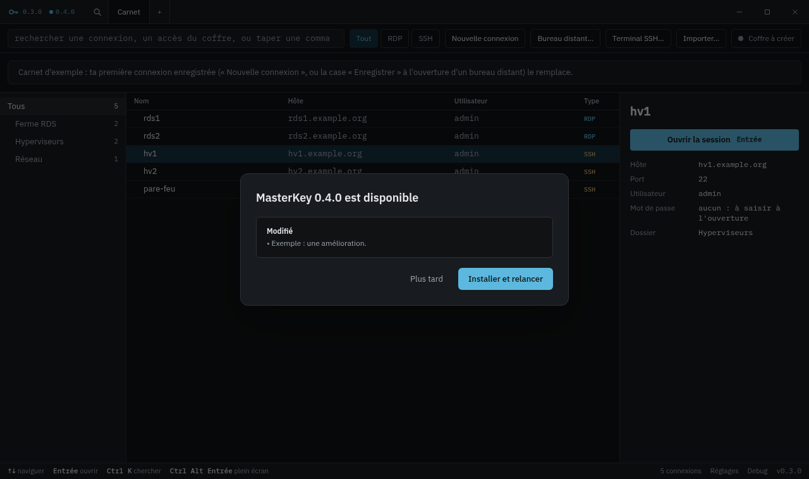

<h1 align="center">MasterKey — versions</h1>

<a href="README.md">English</a>

**MasterKey** est un gestionnaire de connexions de bureau écrit en Rust (Tauri 2, Vue 3) : SSH et RDP en onglets, carnet de
connexions, coffre local chiffré et liaison en lecture seule avec Bitwarden / Vaultwarden. Son code est privé jusqu'à la version 1.

Ce dépôt ne contient **aucun code**. Il publie les installeurs Windows signés, les paquets Linux (AppImage, `.deb`, Arch), leurs
signatures et la fiche `latest.json` que MasterKey lit pour proposer les mises à jour.

## Mises à jour depuis l'application

Quand une version plus récente est publiée ici, son numéro apparaît à côté du logo, dans la barre de titre :

Un clic montre ce qui change et propose **Installer et relancer**. Rien ne s'installe sans ce clic, et les sessions ouvertes sont
rappelées avant la relance :

*(Captures prises sur le carnet d'exemple fourni avec l'application.)*

## Intégrité

- Chaque installeur (Windows) et chaque AppImage (Linux) est signé (minisign). La clé publique est intégrée à MasterKey, qui **refuse tout fichier dont la signature ne
  correspond pas**, d'où qu'il vienne.
- La clé privée ne quitte pas le poste du mainteneur ; l'intégration continue ne signe rien.
- Les installeurs ne sont pas encore signés Authenticode : Windows SmartScreen avertit à la première installation manuelle.

## Installation

Tous les fichiers sont dans la [dernière version](https://github.com/lugio/masterkey-versions/releases/latest).

**Windows** — lancer `MasterKey_x.y.z_x64-setup.exe` (installation pour l'utilisateur, sans droits d'administrateur). Les
versions suivantes arrivent par l'avis de la barre de titre.

**Linux** — au choix :

| Paquet | Pour | Installation | Mises à jour |
|---|---|---|---|
| `MasterKey_x.y.z_amd64.AppImage` | la plupart des distributions | le rendre exécutable (`chmod +x`) et le lancer (FUSE 2 requis : `fuse2` / `libfuse2`) | par l'avis de la barre de titre |
| `MasterKey_x.y.z_amd64.deb` | Debian, Ubuntu et dérivées | `sudo apt install ./MasterKey_x.y.z_amd64.deb` | télécharger la version suivante |
| `masterkey-bin-x.y.z-1-x86_64.pkg.tar.zst` | Arch Linux et dérivées | `sudo pacman -U masterkey-bin-x.y.z-1-x86_64.pkg.tar.zst` | télécharger la version suivante |

Les versions Linux sont construites, installées et lancées par l'intégration continue (le paquet Arch sur Arch même), mais pas
encore éprouvées sur beaucoup de vrais postes : les retours sont bienvenus.

Jusqu'à la v1, chaque version est une **version d'essai**, pour évaluation (publiée comme version normale pour que la fiche de mise à jour la trouve).

## Licence

Voir [LICENSE](LICENSE) : privée jusqu'à la version 1, une licence libre est prévue ensuite.
