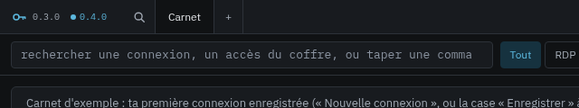
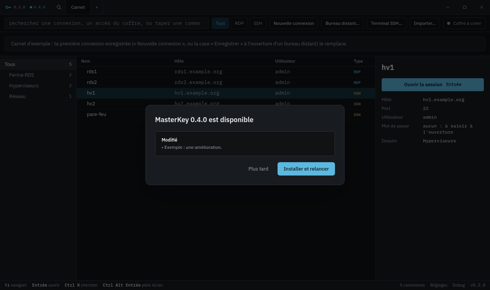

<h1 align="center">MasterKey — releases</h1>

  
  
  

<a href="README.fr.md">Français</a>

**MasterKey** is a desktop connection manager written in Rust (Tauri 2, Vue 3): SSH and RDP in tabs, a bookmark tree, a local
encrypted vault and a read-only link to Bitwarden / Vaultwarden. Its source code is private until version 1.

This repository holds **no code**. It publishes the signed Windows installers, the Linux packages (AppImage, `.deb`, Arch), their
signatures and the `latest.json` file that MasterKey reads to offer updates.

## Updates from inside the app

When a newer version is published here, its number shows up next to the logo, in the title bar:

One click shows what changed and offers **Install and restart**. Nothing is installed without that click, and open sessions are
listed before the restart:

*(Screenshots taken on the built-in sample bookmarks.)*

## Integrity

- Every installer (Windows) and AppImage (Linux) is signed with minisign. The public key is built into MasterKey, which **refuses any file whose signature does
  not match**, wherever it comes from.
- The private key never leaves the maintainer's workstation; continuous integration does not sign anything.
- The installers themselves are not yet Authenticode-signed: Windows SmartScreen will warn on the first manual install.

## Install

All files are in the [latest release](https://github.com/lugio/masterkey-versions/releases/latest).

**Windows** — run `MasterKey_x.y.z_x64-setup.exe` (per-user install, no administrator rights needed). Later versions arrive
through the notice in the title bar.

**Linux** — pick one:

| Package | For | Install | Updates |
|---|---|---|---|
| `MasterKey_x.y.z_amd64.AppImage` | most distributions | `chmod +x` it and run it (needs FUSE 2: `fuse2` / `libfuse2`) | through the notice in the title bar |
| `MasterKey_x.y.z_amd64.deb` | Debian, Ubuntu and derivatives | `sudo apt install ./MasterKey_x.y.z_amd64.deb` | download the next version |
| `masterkey-bin-x.y.z-1-x86_64.pkg.tar.zst` | Arch Linux and derivatives | `sudo pacman -U masterkey-bin-x.y.z-1-x86_64.pkg.tar.zst` | download the next version |

Linux builds are built, installed and launched by continuous integration (the Arch package on Arch itself), but have not yet
been tried on many real desktops: feedback is welcome.

Until version 1, every release is a **test build**, for evaluation (published as a regular release so that the update feed can find it).

## License

See [LICENSE](LICENSE): private until version 1, then an open-source license is planned.
